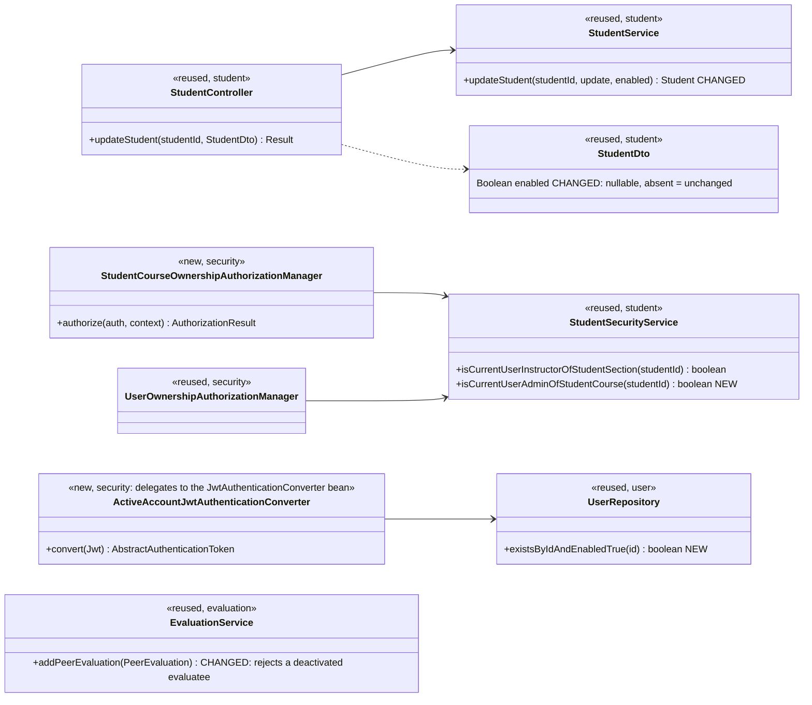
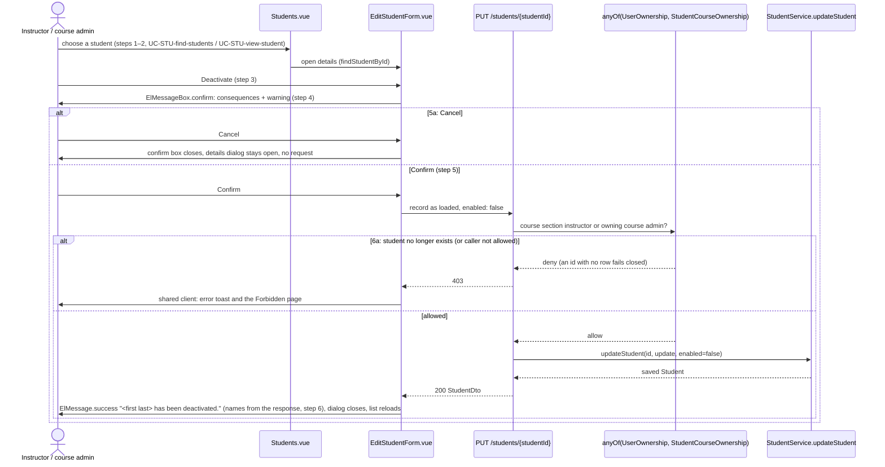
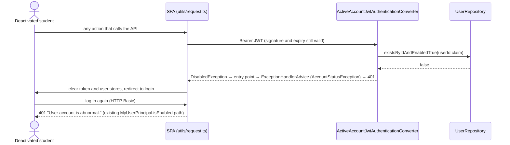
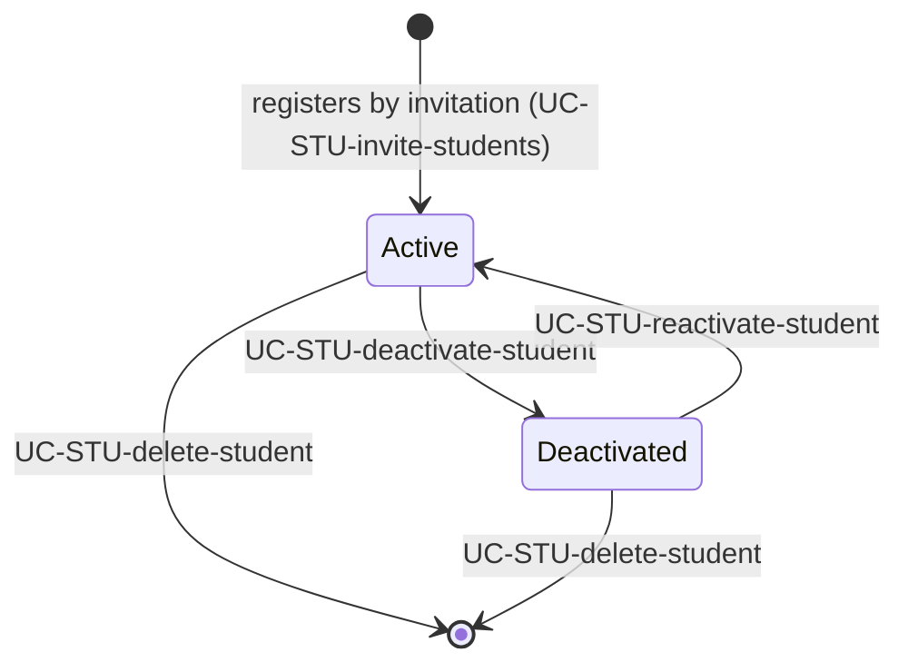

# Students (STU) Design

> Realizes: UC-STU-deactivate-student
> Depends on: FR-SEC-active-account, BR-student-lifecycle, BR-submission-owed, BR-section-scoped-access, BR-role-based-access, CO-ferpa
> See: [use cases](../requirements/use-cases.md#student), [SRS security requirements](../requirements/software-requirements-specification.md#security-and-authorization-requirements), [architectural-design.md](architectural-design.md) (foundation component view, Crosscutting Concepts: Authentication, Authorization)
> Designed against `main` at `59f0267` (2026-11-05).

## Overview

The `student` slice manages student accounts within a course section: inviting, finding, viewing, editing, deactivating, reactivating, and deleting them. It is a foundation feature slice in the REST API container. It was built before this spec set existed, so most of it is design-as-built. This doc starts with UC-STU-deactivate-student. Before this design, a student was deactivated through the Status switch on the edit form. That route had four gaps:

1. It showed no warning and asked for no confirmation.
2. It refused a course admin who wasn't assigned to the course section.
3. It left the student's live JWT working for up to two hours.
4. It let teammates keep submitting peer evaluations of her.

Deactivation is a change to the account's lifecycle state. It does not delete her record, change her membership, or remove her work.

## Components & classes

| Layer | File | Role |
|---|---|---|
| Backend | [`student/StudentController.java`](../../backend/src/main/java/team/projectpulse/student/StudentController.java) | reused; passes the DTO's optional `enabled` to the service |
| Backend | [`student/StudentService.java`](../../backend/src/main/java/team/projectpulse/student/StudentService.java) | `updateStudent` changes `enabled` only when the request carries it **and** `userUtils.hasRole("ROLE_instructor")` is true. That is the literal authority, as the code checks today; a course admin's roles are `admin instructor`, so she carries it too. The check moves from `SecurityContextHolder` to `UserUtils` (Caller identity convention). The student is still loaded by id; see *Point 2* under Key decisions |
| Backend | [`student/dto/StudentDto.java`](../../backend/src/main/java/team/projectpulse/student/dto/StudentDto.java), [`converter/StudentDtoToStudentConverter.java`](../../backend/src/main/java/team/projectpulse/student/converter/StudentDtoToStudentConverter.java) | `enabled` becomes a nullable `Boolean` |
| Backend | [`student/StudentSecurityService.java`](../../backend/src/main/java/team/projectpulse/student/StudentSecurityService.java) | new `isCurrentUserAdminOfStudentCourse`: is the caller the course admin of the student's course? Fails closed like its siblings |
| Backend | [`security/authorizationmanagers/StudentCourseOwnershipAuthorizationManager.java`](../../backend/src/main/java/team/projectpulse/security/authorizationmanagers/StudentCourseOwnershipAuthorizationManager.java) | new; reads `studentId` with `PathVariables.readId` and delegates to the method above |
| Backend | [`security/SecurityConfiguration.java`](../../backend/src/main/java/team/projectpulse/security/SecurityConfiguration.java) | `PUT /students/{studentId}` becomes `anyOf(userOwnership, studentCourseOwnership)`. The resource server is given the new converter below explicitly, `.jwt(jwt -> jwt.jwtAuthenticationConverter(..))`; the existing `jwtAuthenticationConverter` bean is unchanged and becomes its delegate. Spring Security adopts a converter bean only when it is typed `JwtAuthenticationConverter`, so returning the wrapper from that bean would be silently ignored in favour of a default converter that drops the `authorities` claim mapping |
| Backend | [`security/ActiveAccountJwtAuthenticationConverter.java`](../../backend/src/main/java/team/projectpulse/security/ActiveAccountJwtAuthenticationConverter.java) | new `@Component`; a `Converter<Jwt, AbstractAuthenticationToken>` that delegates to the `JwtAuthenticationConverter` bean, then throws `DisabledException` unless `existsByIdAndEnabledTrue(userId claim)`; a missing or non-numeric `userId` claim is refused the same way |
| Backend | [`user/UserRepository.java`](../../backend/src/main/java/team/projectpulse/user/UserRepository.java) | new `existsByIdAndEnabledTrue(Integer id)` |
| Backend | [`evaluation/EvaluationService.java`](../../backend/src/main/java/team/projectpulse/evaluation/EvaluationService.java) | `addPeerEvaluation` throws `PeerEvaluationIllegalArgumentException` for a deactivated evaluatee, checked after the existing same-team check. One `POST` carries one evaluatee, and the server has no completeness check that would need changing |
| Frontend | [`pages/students/EditStudentForm.vue`](../../frontend/src/pages/students/EditStudentForm.vue) | the student details dialog (UC-STU-view-student). Status switch removed; status shown as a tag: `Active` (success) or `Deactivated` (info). A **Deactivate** button (`type="danger"`, in the dialog footer, left of Cancel and Confirm) appears only while the student is active. Save sends no `enabled` |
| Frontend | [`apis/student/types.ts`](../../frontend/src/apis/student/types.ts) | unchanged: `enabled` was already optional on `Student` |
| Frontend | [`pages/evaluations/SubmitTeamsEvaluations.vue`](../../frontend/src/pages/evaluations/SubmitTeamsEvaluations.vue) | leaves out teammates whose `enabled` is false. `GET /students/teams/{teamId}` already returns `enabled` in each `StudentDto`, so no backend change is needed |
| Frontend | [`pages/students/Students.vue`](../../frontend/src/pages/students/Students.vue) | the status tag reads `Active` or `Deactivated`, matching the dialog (it read Enabled or Disabled) |

## Sequence

### UC-STU-deactivate-student: deactivate

### FR-SEC-active-account: the deactivated account's next request

### Account lifecycle

## API contract

| Endpoint or job | Caller (who may) | Request | Success | Errors, by extension |
|---|---|---|---|---|
| `PUT /api/v1/students/{studentId}` (changed) | The student herself (profile fields only), an instructor assigned to her course section, or the course admin who owns her course (BR-student-lifecycle, BR-section-scoped-access): `anyOf(userOwnershipAuthorizationManager, studentCourseOwnershipAuthorizationManager)` | `username`, `firstName`, `lastName`, `email` (validated as today); optional `enabled`. Absent means unchanged; it is applied only when the caller holds `ROLE_instructor`, and ignored for a student caller | `200` `StudentDto` (includes `enabled`) | 6a, and any caller not allowed: `403` from the route rule, because the managers fail closed on an id that names no row. The service's `404` is reached only if the student is deleted between the rule and the load. Invalid profile fields: `400` |
| Every Bearer-authenticated request (changed) | Any holder of a JWT | — | unchanged | The `userId` claim names an account that is deactivated or no longer exists: `401` with the `Result` message "User account is abnormal." (`DisabledException` reaches `ExceptionHandlerAdvice`'s `AccountStatusException` handler through the bearer entry point), before any authorization rule runs. It applies to every request that carries a Bearer token, `permitAll` routes included; a request without a token is unaffected |
| `POST /api/v1/evaluations` (changed) | unchanged | unchanged | unchanged | Evaluatee deactivated: `400` `INVALID_ARGUMENT`, "This student's account is deactivated." Nothing is saved |

UC-STU-reactivate-student will reuse the same `PUT` with `enabled: true`; its button and its notification email are designed under that use case.

## Key decisions

**Reuse the existing `PUT`, no new endpoint.** The warning and the confirmation (steps 4–5) are a page concern, an `ElMessageBox.confirm` in the details dialog, so the server sees only the confirmed change. Rejected: dedicated `PATCH /students/{id}/deactivate` and `/reactivate` endpoints. They'd change only the flag and could refuse an already-deactivated student, but at the cost of more code for little gain. Accepted consequences:
- Deactivate re-saves the name and email as loaded, so an edit someone else made in between is overwritten. That's unlikely at this frequency.
- Two concurrent deactivations both succeed, which is harmless because the end state is the same. PRE-2 holds when the flow starts because the button only appears for an active student.

**The confirmation (step 4).** `ElMessageBox.confirm` with `type: 'warning'`, title "Deactivate <first last>?", buttons "Deactivate" and "Cancel", and this body, taken from the Associated Information: "<first last> will no longer be able to log in or submit weekly activity reports and peer evaluations. Her account, her submitted work, and her course section and team membership are kept, and her teammates will no longer owe or be able to submit a peer evaluation of her. She can be reactivated later. This is not a deletion." The `PUT` carries the record as it was loaded when the dialog opened, not unsaved edits in the form; those are discarded when the dialog closes.

**6a surfaces as `403`, not as a "not found" message.** Both managers fail closed on an id that names no row, by the architecture's *Guards fail closed, and never throw* rule, so a student deleted after her details were shown gets `403`. The shared client (`frontend/src/utils/request.ts`) then shows its error toast and the Forbidden page, and that is the 6a alert; the use case's 6a says the student "cannot be found or can no longer be changed" to match. Rejected: letting the managers admit a missing id so the service can return `404`, which reopens the id oracle that rule closes. Also rejected: a per-call opt-out from the client's `403` handling so the dialog can say "not found", a new client mechanism for a rare race.

**Point 2: the student is loaded by id.** The architecture's point 2 prefers a query scoped to the caller. Here the route's only id is the student's own, and both managers resolve *her* course section and course, so the gap point 2 closes (a container id in the URL beside another container's object) cannot arise. Rejected: a finder scoped to the caller's default course section (`UserUtils.getUserSectionId`), which would refuse a course admin acting outside her default course section and an instructor assigned to several course sections whose default isn't the student's.

**`enabled` is optional, and absent means unchanged.** The Save button sends no `enabled`, and only the Deactivate (and later Reactivate) action sends it. Rejected: Save sending the `enabled` it loaded. An edit dialog opened before someone else deactivated the student would then quietly reactivate her on Save. Also rejected: keeping the primitive `boolean`, because a field the client leaves out would bind as `false` and deactivate a student on every profile edit.

**Deactivation takes effect on the next request** (FR-SEC-active-account). A converter that delegates to the existing `JwtAuthenticationConverter` bean, set on the resource server explicitly (see Components), calls `existsByIdAndEnabledTrue` on the token's `userId`. It throws `DisabledException` when the result is false, and `BearerTokenAuthenticationFilter` turns that into a `401` through the existing entry point. The SPA's `401` handler then logs her out. The check is one primary-key existence query per request, with no entity load. Because it reads the shared `PeerEvaluationUser` table, it covers instructors too (UC-INS-deactivate-instructor). Rejected:
- Accepting the 2-hour token window, which is what the code does today. A deactivated student could keep submitting work, against FR-SEC-active-account.
- A token-version claim bumped on deactivation, which needs the same per-request lookup plus a column and a migration.

[TD-jwt-revocation](architectural-design.md#risks-and-technical-debt) stays open for leaked tokens of *active* accounts.

**Who may deactivate.** An instructor assigned to the student's course section, or the course admin who owns her course (BR-student-lifecycle, BR-section-scoped-access, BR-role-based-access). The existing `UserOwnershipAuthorizationManager` admits the first, plus the student herself, whose `enabled` the service ignores. A new `StudentCourseOwnershipAuthorizationManager` admits the second, and the two are composed with `AuthorizationManagers.anyOf`, as the `submission-status` and `reminders` routes do. Rejected: adding the course-admin check inside `UserOwnershipAuthorizationManager`, which would also widen `GET` and `DELETE /students/{id}` and every route that binds `evaluatorId`.

**Membership and work are kept.** She stays in her course section and on her team. Her weekly activity reports and peer evaluations, both those she wrote and those written about her, are untouched. Rejected: removing her from her team, which would detach her work from its team context and make reactivation lose information.

**Peer evaluations of a deactivated student.** BR-submission-owed already stops her teammates owing her one. The submit page also leaves her out, and `addPeerEvaluation` rejects a new evaluation of her, so the page and the API agree. Updating an evaluation already submitted (`PUT /evaluations/{id}`) is still allowed within its window, because kept work stays editable. Rejected: hiding her in the page only, which would leave the API accepting what the rule says nobody owes.

## Data model

No delta. `PeerEvaluationUser.enabled` already holds the account status, as the SRS's [Business Domain Model](../requirements/software-requirements-specification.md#business-domain-model) defines it. There is no new column, index, or migration; the per-request check reads the primary key.

## Reuse & cross-cutting

- **Authorization:** `UserOwnershipAuthorizationManager` and the new `StudentCourseOwnershipAuthorizationManager`, composed with `anyOf`; route rule placed before the `denyAll()` catch-all as today.
- **Authentication:** the existing Basic-login disabled check (`MyUserPrincipal.isEnabled` → `AccountStatusException` → `401`), and the existing bearer entry point for the new per-request check.
- **Errors:** `ObjectNotFoundException` → `404`; `PeerEvaluationIllegalArgumentException` → `400` through `ExceptionHandlerAdvice`.
- **Client:** the shared Axios instance's `401` handling (`frontend/src/utils/request.ts`) logs the deactivated user out. No new client code is needed for that.
- **Reminders and reports:** `SubmissionStatusService` already skips deactivated students ([not.md](not.md)). This design doesn't change it.

## Tests

| Use case, flow | Level | Asserts |
|---|---|---|
| UC-STU-deactivate-student main, course section instructor | integration | An instructor assigned to the student's course section sends `PUT` with `enabled:false` → `200`, `enabled` false on read-back; her activities and peer evaluations still exist |
| UC-STU-deactivate-student main, course admin | integration | The course admin who owns the course but is not assigned to the course section → `200` |
| UC-STU-deactivate-student authorization | integration | An instructor of another course section, a course admin of another course, and another student → `403` with the `Result` envelope; the student herself sending `enabled:false` → `200` with `enabled` unchanged |
| UC-STU-deactivate-student, absent `enabled` | integration | `PUT` without `enabled` on a deactivated student leaves her deactivated; on an active one leaves her active |
| UC-STU-deactivate-student step 6, FR-SEC-active-account | integration | A JWT issued to the student before deactivation → `401` on a protected `GET` afterwards; HTTP Basic login → `401` (assert the status and `Result` code, not the message text) |
| FR-SEC-active-account, instructor | integration | A deactivated instructor's previously issued JWT → `401` |
| UC-STU-deactivate-student 5a | E2E (Cypress, API stubbed) | Cancelling the confirm dialog sends no `PUT` |
| UC-STU-deactivate-student steps 3–6, UI | E2E (Cypress, API stubbed) | Deactivate appears only for an active student; the dialog shows the consequences text; Confirm sends `enabled:false` and shows the success message; Save sends no `enabled` |
| UC-STU-deactivate-student 6a | integration | `PUT` for a student id that doesn't exist → `403` with the `Result` envelope, and no row is created |
| Peer evaluation of a deactivated student | unit and integration | `addPeerEvaluation` with a deactivated evaluatee → `400` with the message; no row saved |
| Peer evaluation page | E2E (Cypress, API stubbed) | A deactivated teammate is not listed on the submit page |

Test fixtures: use the seeded users where they fit, and create in the test's setup any the seed lacks (for example a course admin who owns the course but is not assigned to the student's course section). `AbstractIntegrationTest` rolls each test back (`@Transactional`), and MockMvc runs the filter chain on the test's thread, so a user a test deactivates is restored for the next test.

## Open questions / risks

- **Reactivation has no UI until UC-STU-reactivate-student is built.** Removing the Status switch removes the only way to reactivate today. That use case reuses the same `PUT` with `enabled: true` and adds its notification email. Design it next.
- **Delete authorization is tracked separately** (OI-65). The rule is: section instructor or owning course admin. The spec says course admin only, and the `DELETE` route's manager disagrees with both. Out of scope for this design.
- **Per-request lookup cost.** One existence query by primary key per request. That's negligible at course scale (about 80 students, a handful of instructors). Not measured.
- **A page already on screen.** Deactivation logs her out on her next API call, not instantly. Whatever is already loaded stays visible until then, but nothing new can be read or saved.
